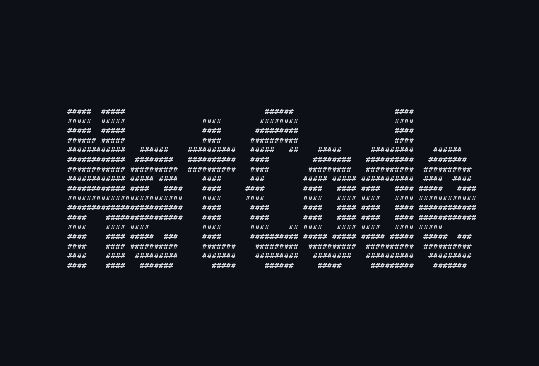

<h1 align="center">Edwin Metcalf</h1>

  

  Software Engineer | Systems · Local AI · Agentic Assistants · Eval | <a href="https://edwinmetcalf.com">edwinmetcalf.com</a>

  Hey! I'm a software engineer who enjoys building and optimized intersting things(currently MetCode)! I have
  worked systems projects including compilers, networking, and security. However now I am focused on MetCode and 
  how to optimize Agentic assistants. A big part of this is evaluation and to understand evaluating agentic agents
  I also spent time building an evaluation harness for robot policies.

  I studied Computer Science and History at Vassar College, with additional coursework at UC Berkeley. Outside of
  the programming world, I'm into video games, sports, and the outdoors I love to backpack and am always planning
  my next trip.

  
  
  
  

## Featured Projects

### [MetCode](https://github.com/Edwin-metcalf/MetCode)
Local command-line AI coding agent, optimized for small models and budget hardware, and fully offline.  
`Go` · `Ollama`

### [Personal Website](https://www.edwinmetcalf.com/)
My live portfolio and home base on the web — built and deployed with Svelte, TypeScript, Go, PostgreSQL, and Heroku.
Try the clash royale matchup generator [here!](https://www.edwinmetcalf.com/games/game-stats/clash-royale/matchup-generator)

### [IsaacSim Robot Project](https://github.com/Edwin-metcalf/IsaacSim-Robot-Project)
Closed-loop evaluation framework for Vision Language Models on spatial reasoning and robotic pick-and-place. 
Evaluated LeRobot policies, diffusion and VQ-BeT, on PushT task.
`NVIDIA Isaac Sim` · `Vision Language Models` · `LeRobot policies`

### Systems Work
- **Compiler:** parsing, type checking, optimization, and RISC-V assembly generation.
- **Secure File Sharing:** encrypted storage and sharing with AES-CTR, RSA signatures, HMACs, and key derivation.
- **BitTorrent Client:** peer-to-peer client in C using UDP sockets, concurrency, and sliding-window reliability.

<!-- will eventually add this stuff once I have the map generator done 
### 🏔️ Field Log

A log of the trails I've been lucky enough to walk.

| Trip | Year | Highlight |
|---|---:|---|
| **Pacific Crest Trail** — Sonora Pass → Tuolumne Meadows | 2026 | Father–son trip |
| **Mt. Shasta** — Hotlum Glacier Route | 2026 | — |
| **Wind River High Route** — Hay Pass → Indian Pass | 2026 | Loop of DDD |
| **Mt. Snowdon**, Wales | 2024 | Highest point in Wales |
| **Mt. Tioga** | 2023 | Very wet — caught in Hurricane Hilary |
| **Mt. Baker** | 2019 | At camp |
-->

### 🧰 Languages and Tools

  
  
  
  
  
  
  
  
  
  
  
  
  
  
  

   

 <!-- Temporarily commented out pretty generic idk  
### 💻 GitHub Stats

  <!-- Temporarily commented out
  

  

-->

### 🐍 Contribution Snake

<!-- Generated nightly by .github/workflows/snake.yml (Platane/snk) -->
<picture>
  <source media="(prefers-color-scheme: dark)" srcset="assets/snake-dark.svg" />
  <source media="(prefers-color-scheme: light)" srcset="assets/snake.svg" />
  
</picture>

  

